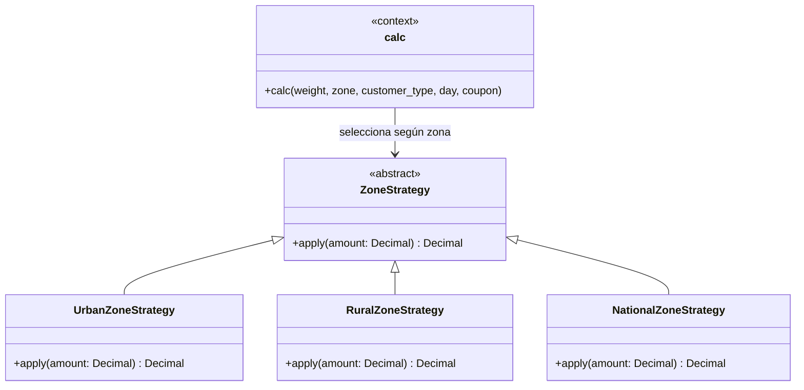

# Parte 6 — Mantenimiento y refactorización

## Malos olores del código heredado

Las referencias de línea corresponden a `envios.py` antes de refactorizar (versión heredada analizada en la Parte 5).

| Mal olor | Líneas | Deuda técnica |
|---|---:|---|
| Long Method | 11–40 | `calc` concentra validación, tarifa, zona, fin de semana, descuentos, mínimo, redondeo e impresión; cualquier cambio exige entender y volver a probar toda la rutina. |
| Magic Numbers | 12, 15–19, 27–40 | Límites, tarifas, porcentajes y redondeo están dispersos; una regla puede cambiarse de forma incompleta o inconsistente. |
| Primitive Obsession | 11, 20–35 | Zona, cliente, día y cupón se representan como valores primitivos sin estrategias ni abstracciones que protejan sus reglas. |
| Flag Argument | 11, 38–39 | `flag` cambia el efecto lateral de cálculo a impresión; amplía la interfaz y obliga a considerar dos comportamientos en cada llamada. |
| Switch Statements | 20–25, 29–35 | Condicionales por zona y cliente mezclan políticas de negocio con el cálculo y hacen más costoso agregar variantes. |
| Redundant Code (asignación no-op) | 20–21 | La rama urbana ejecuta `t = t`, que no modifica el resultado y distrae de las reglas reales. |
| Long Parameter List | 11 | Seis argumentos posicionales (`p`, `z`, `c`, `d`, `cup`, `flag`) dificultan leer y llamar correctamente la función. |
| Mysterious Name | 11–40 | Nombres como `p`, `z`, `c`, `d`, `cup` y `t` ocultan el significado y elevan el costo de revisión y mantenimiento. |

## Clasificación del mantenimiento

| Cambio | Clasificación | Motivo |
|---|---|---|
| Rechazar zona y día inválidos (DEF-01). | Correctivo | Corrige entradas inválidas aceptadas por el legado. |
| Aplicar el recargo también el sábado (DEF-02). | Correctivo | Alinea el cálculo con R5. |
| Redondear al centenar más cercano, con mitades hacia arriba (DEF-03). | Correctivo | Corrige resultados truncados; `Decimal` evita errores binarios en los límites. |
| Devolver el mensaje exacto `peso inválido` (DEF-04). | Correctivo | Alinea el error con R1. |
| Extraer funciones, usar constantes con nombre y nombres descriptivos. | Preventivo | Reduce duplicación conceptual, valores inconsistentes y errores en cambios futuros. |
| Aplicar Strategy a las zonas y retirar `flag`. | Perfectivo y preventivo | Aísla las políticas de zona y simplifica el cálculo. Quitar `flag` cambia la interfaz pública de `calc`; no se conserva compatibilidad con llamadas que aún lo envíen. |
| Adaptativo. | No aplica | No se modificaron plataforma, sistema operativo ni entorno de ejecución. |

## Refactorización y estrategia de zona

`calc` coordina el flujo y delega la tarifa base, descuentos, redondeo y recargo de zona. Las estrategias mantienen separadas las reglas urbana, rural y nacional. Se conservó el orden de R1–R8: tarifa, zona, fin de semana, descuento del cliente, cupón, mínimo y redondeo.



Los descuentos se expresan mediante tasas con nombre y una tabla de descuentos por tipo de cliente; los cupones desconocidos se siguen ignorando. El comportamiento de un tipo de cliente no especificado por el enunciado permanece sin definir y pendiente de confirmación, no se presenta como requisito.

## Defectos corregidos

| Defecto de la Parte 5 | Corrección aplicada |
|---|---|
| DEF-01 — zona y día no validados | Solo se aceptan las zonas definidas y días enteros del 1 al 7; entradas inválidas producen `ValueError`. |
| DEF-02 — sábado sin recargo | El recargo se aplica en los días 6 y 7 antes de los descuentos. |
| DEF-03 — truncamiento | Se usa aritmética decimal y `ROUND_HALF_UP` al múltiplo de $100 más cercano. |
| DEF-04 — mensaje incorrecto | El peso inválido ahora produce exactamente `peso inválido`. |

## Regresión y métricas

La regresión conserva los 38 casos de caja negra CP01–CP38. Se retiró la prueba del argumento `flag`, eliminado como pide la refactorización, y se añadieron cinco comprobaciones de bordes: pesos no finitos y días booleanos, fraccionarios o textuales.

Ejecución con Python 3.13.0, pytest 9.2.0 y pytest-cov 7.1.0:

```text
43 passed

Name        Stmts   Miss Branch BrPart  Cover
---------------------------------------------
envios.py      73      0     12      0   100%
---------------------------------------------
TOTAL          73      0     12      0   100%
```

La salida completa está en [`evidencia/pytest-regresion.txt`](../evidencia/pytest-regresion.txt).

| Métrica de `envios.py` | Antes (Parte 5) | Después |
|---|---:|---:|
| Complejidad ciclomática máxima por función | 15 (`calc`) | 9 (`calc`); las funciones auxiliares tienen complejidad 1–3. |
| Suma de complejidad por función | 15 | 20, debido a la extracción de funciones y estrategias. |
| Líneas físicas | 40 | 122 |
| Cobertura de sentencias | 100 % | 100 % |
| Cobertura de ramas | 100 % | 100 % |
| Defectos raíz de la Parte 5 corregidos | 0 | 4 de 4 |

La complejidad de `calc` se calculó como `1 + decisiones + operadores booleanos + manejadores de excepción`; la cifra heredada corresponde al grafo de flujo de la Parte 4. La suma aumenta porque el comportamiento se distribuye entre más funciones; por eso también se informa la complejidad máxima individual y no se afirma que la complejidad total del módulo haya disminuido. Las 82 líneas adicionales corresponden principalmente a estrategias explícitas, funciones extraídas, constantes y tipos.
